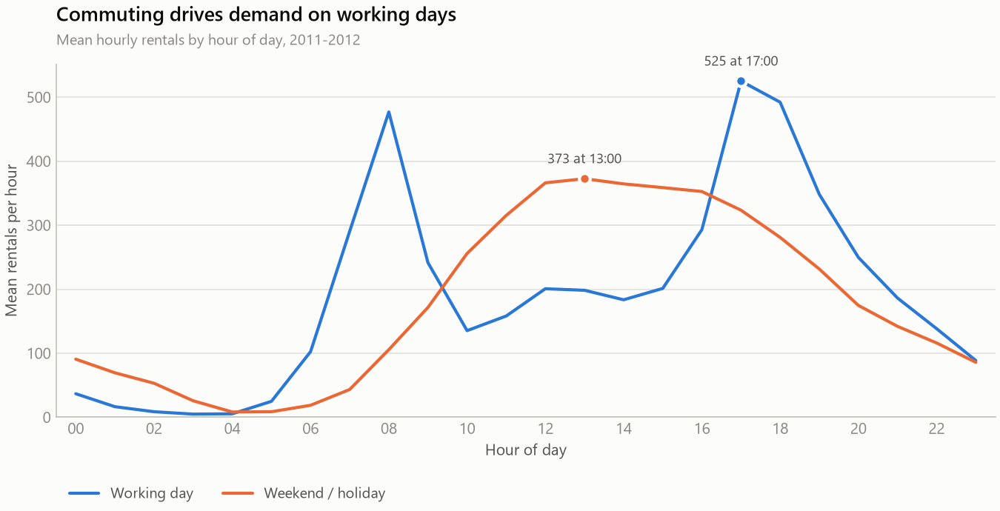
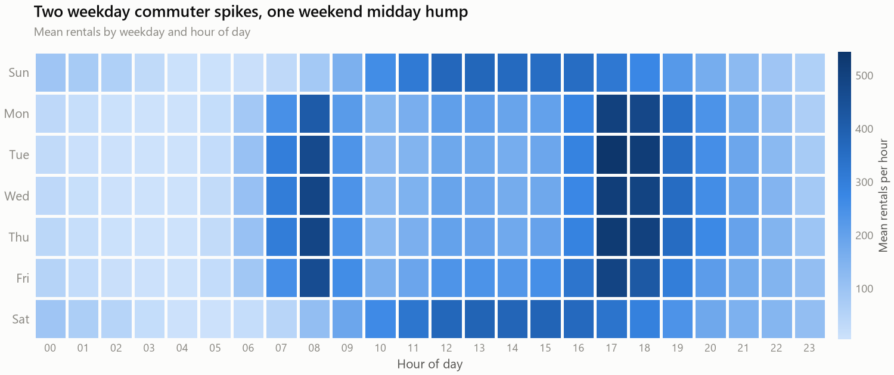
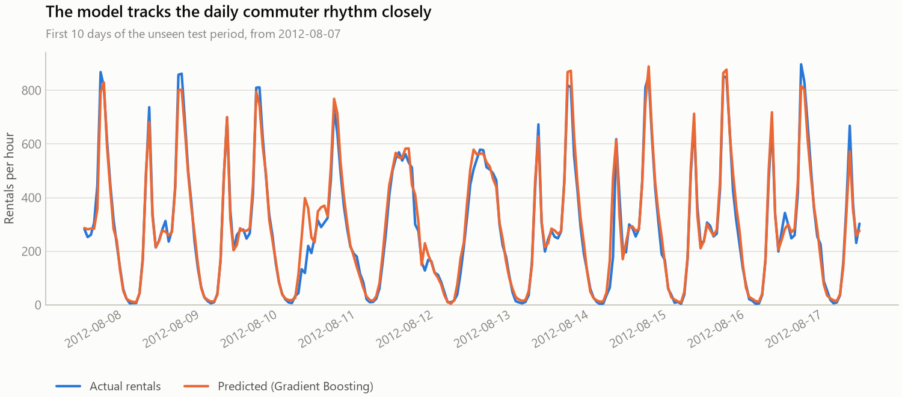

# Bike Sharing Demand: Descriptive, Visual and Predictive Analysis

Analysis of **17,379 hours** of bike-share activity from Capital Bikeshare,
Washington D.C. (2011–2012). The project covers all three analysis types:
**descriptive statistics**, **data visualization**, and **predictive modelling**.

A Gradient Boosting model forecasts hourly rental demand with **R² 0.92** on
hours it has never seen — a **73% reduction in error** against a naive baseline.

---

## Headline results

| Measure | Value |
|---|---|
| Total rentals analysed | 3,292,679 |
| Year-on-year growth | +64.9% (1,243,103 → 2,049,576) |
| Mean demand | 189.5 rentals/hour (median 142, skewness +1.28) |
| Peak vs quietest hour | 72.6× (17:00 against 04:00) |
| Registered rider share | 81.2% |
| Weather penalty | −63.7% in heavy rain or snow |
| **Best model** | **Gradient Boosting — RMSE 62.3, MAE 40.0, R² 0.92** |

## Key findings

1. **Demand is driven by time, not weather.** Time-of-day features carry ~61% of
   predictive importance; every weather feature combined carries ~20%.
2. **There are two businesses sharing one fleet.** Working days are
   commuter-shaped (peaks at 08:00 and 17:00, 13.2% casual riders); weekends are
   leisure-shaped (one midday hump, 31.7% casual).
3. **The service grew 64.9% year on year**, almost entirely through registered
   members.
4. **Weather modulates, it does not determine.** Heavy rain or snow cuts hourly
   demand by 63.7%, but the daily shape survives intact.
5. **Hourly demand is genuinely predictable** — R² 0.92 on unseen future hours.
6. **Evaluation design changes the answer.** A random split flatters every model
   by 15–30 RMSE and is the wrong test for a forecasting problem.

---

## Two methodological points worth the reader's time

**Target leakage.** `cnt` is exactly `casual + registered` in all 17,379 rows.
A model given those two columns reconstructs the target perfectly and reports
flawless accuracy while having learned nothing. Both are dropped from the
feature set — this is the most common error made with this dataset, and nothing
in the output announces it.

**Chronological validation.** The deployment question is forward-looking, so the
model trains on the earliest 80% of hours and is tested on the most recent 20%.
A random split is reported alongside, and the gap is a finding in itself:

| Model | Chronological RMSE | Random RMSE | Optimism gap |
|---|---:|---:|---:|
| Gradient Boosting | 62.3 | 38.0 | +24.2 |
| Random Forest | 72.3 | 41.3 | +30.9 |
| Decision Tree | 86.0 | 54.4 | +31.6 |
| Linear Regression | 133.8 | 97.8 | +36.1 |

Shuffling lets a model train on hours that sit *between* the hours it is tested
on, so it interpolates inside a series it has already seen rather than
forecasting beyond it. Quoting the random-split figure as forecasting accuracy
would overstate real performance by roughly a third.

---

## Deliverables

| Deliverable | File |
|---|---|
| Jupyter notebook (code + narrative, fully executed) | [`notebooks/Bike_Sharing_Demand_Analysis.ipynb`](notebooks/Bike_Sharing_Demand_Analysis.ipynb) |
| PDF report (16 pages) | [`report/Bike_Sharing_Demand_Report.pdf`](report/Bike_Sharing_Demand_Report.pdf) |
| Slide deck (20 slides) | [`slides/Bike_Sharing_Demand_Deck.pptx`](slides/Bike_Sharing_Demand_Deck.pptx) |

## Selected figures

### Two different demand patterns share one fleet


### The commuter band is visible by eye


### Forecasts track the real commuter rhythm


All 12 figures are in [`figures/`](figures/).

---

## Repository structure

```
.
├── data/raw/                 # UCI Bike Sharing dataset (hour.csv, day.csv, Readme.txt)
├── src/
│   ├── data_prep.py          # loading, de-normalisation, labelling, quality report
│   ├── viz_style.py          # the design system: palette, mark specs, helpers
│   ├── descriptive.py        # descriptive statistics + figures 1–8
│   ├── modeling.py           # feature engineering, 4 models + figures 9–12
│   └── build_report.py       # generates the PDF report
├── notebooks/                # executed analysis notebook
├── slides/build_deck.js      # generates the PowerPoint deck
├── figures/                  # all 12 generated figures (PNG)
├── outputs/
│   ├── metrics.json          # every number quoted anywhere in the project
│   └── tables/               # summary tables as CSV
├── report/                   # generated PDF
└── requirements.txt
```

**One source of truth.** The notebook, the PDF and the deck all read their
numbers from `outputs/metrics.json` and their charts from `figures/`, both
produced by the same modules in `src/`. The three documents cannot disagree with
each other, because none of them contains a hand-typed statistic.

---

## Reproducing the analysis

```bash
pip install -r requirements.txt

cd src
python descriptive.py     # statistics, CSV tables, figures 1–8
python modeling.py        # trains 4 models, figures 9–12
python build_report.py    # builds the PDF report
```

To rebuild the slide deck (requires Node.js):

```bash
npm install pptxgenjs
node slides/build_deck.js
```

To re-run the notebook end to end:

```bash
cd notebooks
jupyter nbconvert --to notebook --execute --inplace Bike_Sharing_Demand_Analysis.ipynb
```

---

## Methodology

**Data preparation.** The raw weather columns ship min–max normalised; they are
restored to physical units (°C, %, km/h) so every chart and table is directly
interpretable. 165 hours (0.94% of the calendar) are absent from the series and
are excluded rather than zero-imputed — inserting artificial zero-demand hours
would drag every mean downward.

**Feature engineering.** Hour 23 and hour 00 are adjacent in time but maximally
distant as integers, so hour, month and weekday are additionally encoded as
sine/cosine pairs, letting the models treat the clock as the circle it is.

**Models.** Linear Regression, Decision Tree, Random Forest and Histogram
Gradient Boosting, each measured against a naive baseline that always predicts
the training mean. Validation is a chronological hold-out, with a random
hold-out and 5-fold `TimeSeriesSplit` cross-validation reported alongside
(mean RMSE 72.6 ± 22.0).

**Visualization.** Every figure is drawn through one design system
(`src/viz_style.py`): chart form is chosen by the job the data has to do, and
colour is assigned by role — a colour-vision-validated categorical palette for
distinct series, a single-hue ramp for magnitude, and a diverging ramp with a
neutral grey midpoint for correlation. Marks are thin with rounded data-ends,
gridlines are hairline and recessive, and labels are selective rather than
printed on every point.

## Limitations

- **Two years, one city.** Washington D.C., 2011–2012. The growth term is fitted
  on two annual points and must not be extrapolated past 2012.
- **Observed rather than forecast weather.** In production the model would
  receive a forecast, which carries its own error, so live accuracy would be
  lower than reported here.
- **Severe class imbalance** — only 3 hours of heavy rain/snow in the entire
  dataset.
- **Events are not modelled.** The quietest day in two years (29 Oct 2012, 22
  rentals) is Hurricane Sandy; no feature captures events like it.
- **No spatial dimension**, so the analysis cannot inform station-level
  rebalancing.

## Data source

Fanaee-T, H. and Gama, J. (2013). *Event labeling combining ensemble detectors
and background knowledge.* Progress in Artificial Intelligence, 2(2–3),
pp. 113–127. Springer Berlin Heidelberg.
[UCI Machine Learning Repository — Bike Sharing Dataset](https://archive.ics.uci.edu/dataset/275/bike+sharing+dataset)
